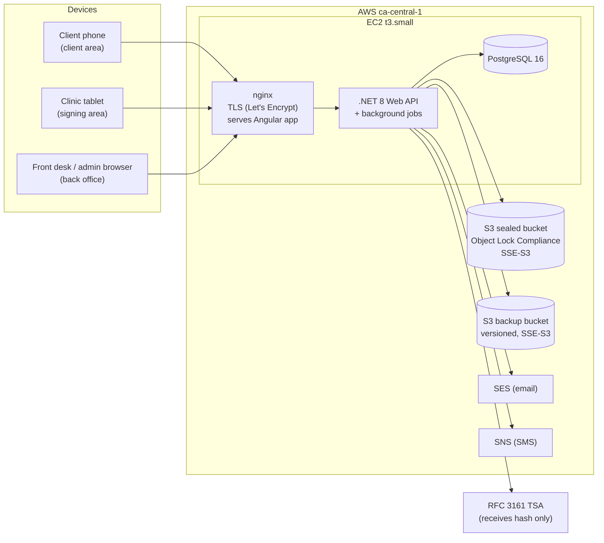
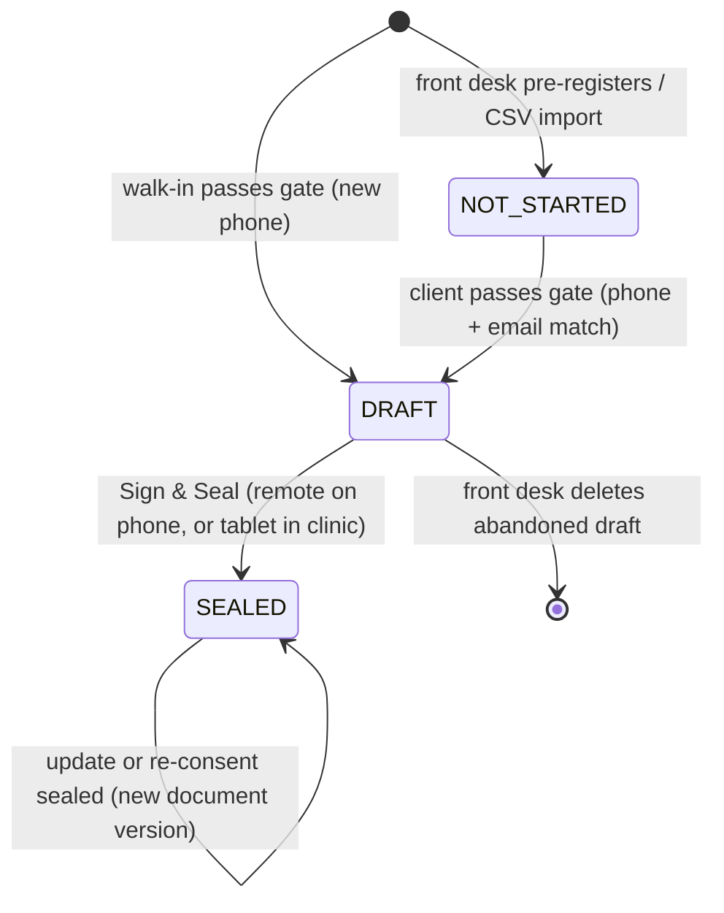
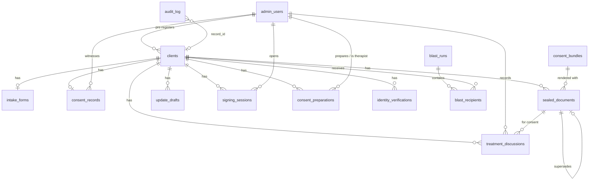
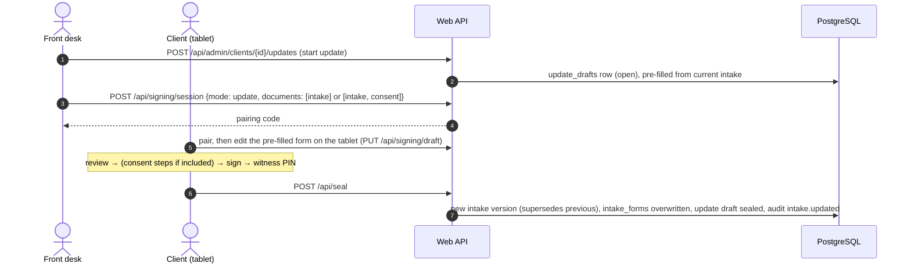

# ConsentSeal — Design v2

> **Status:** Draft for review, 2026-10-07.
> **This document replaces `ConsentSeal-TECHSPEC-CLAUDE-CODE.md` as the single source of truth for building ConsentSeal.** `ConsentSeal-DESIGN.md` (v1) and the TECHSPEC are kept for history only. Where they disagree with this document, this document wins.
> Inputs: `ConsentSeal-BACKGROUND.md`, `ConsentSeal-DESIGN.md`, `ConsentSeal-TECHSPEC-CLAUDE-CODE.md`, `field-mapping.md`, Experiments 01 and 02 (both built and verified), and all rulings made in review up to 2026-10-07.
> Items marked **[Lawyer]** need legal sign-off before Phase 3. Items marked **[Default]** were proposed by Claude Code and accepted by Steven on 2026-10-07. Items marked **[Provisional]** are working assumptions not yet confirmed by Steven (listed in §24.2).
> **Revision 2026-10-07 (b): v1 supports remote signing.** Clients can sign both forms on their own phone (identity = phone + email match only), or in the clinic on the tablet with a staff witness. Updates and re-consent can also be done remotely.

---

## Contents

1. Purpose and goals
2. Design rules
3. Scope: v1, non-goals, future
4. People and roles
5. Architecture
6. Technology and repository layout
7. Lifecycle and state model
8. Database design
9. Identity gate
10. Intake form rules
11. Signing session and sealing
12. PDF generation
13. Updates and re-consent
14. Back office
15. Evidence chain: audit log, hashes, timestamps, anchors
16. Security and privacy
17. API reference
18. Frontend design
19. Scenarios (complete list)
20. Testing strategy
21. Deployment and operations
22. Cost
23. Implementation phases
24. Open items (business and legal)
25. Decision log
26. Future (v2 and later)

---

## 1. Purpose and goals

**SELAH HEAD SPA** (the clinic) wants clients to pay for treatments with their extended-health insurance (Sun Life, Manulife, Canada Life and similar). Insurers require the clinic to keep, for each client, a **signed Health History (intake) form** and a **signed treatment consent form**, and they audit these records when reviewing claims. An audit checks:

- the forms exist and are signed;
- they were signed **before** the treatment;
- the treatment areas the client consented to match what was billed.

ConsentSeal replaces the paper forms:

1. The client fills in the intake form on their phone before the visit (or on arrival).
2. Front desk prepares the consent details when booking (therapist, treatment areas, scope).
3. The client signs by hand, either **remotely on their own phone** once everything is complete, or **in the clinic on a tablet** with a staff member as witness.
4. At that moment the system produces the signed PDFs, **seals** them (fingerprint, trusted timestamp, tamper-proof storage) and records who, when, how and what in a tamper-evident log.
5. Before treatment, the therapist records that they discussed the treatment with the client; at the first visit, front desk records an in-person ID check for clients who signed remotely.
6. When an insurer asks, the clinic finds and downloads the sealed PDFs in seconds, and can prove they were not changed.

**Goal:** the electronic record must be **stronger evidence than paper**, not merely equivalent.

## 2. Design rules

Breaking any of these is a design failure.

| # | Rule | Why |
|---|---|---|
| R1 | **Sign and seal at the same moment.** The PDF is created once, at signing. Retrieval always returns that exact file and never re-renders it. | A re-rendered file has a different fingerprint and proves nothing. |
| R2 | **Templates are read-only.** The original PDFs are only ever used as a background. The program never writes to them. | The output must be the clinic's real form, filled in. |
| R3 | **The fingerprint (SHA-256) covers only the PDF bytes.** Never storage paths or database fields. | Storage locations change; evidence must not. |
| R4 | **Evidence beyond paper.** Every step that paper leaves unrecorded (who witnessed, which ID was checked, which text was shown, when) is recorded. | The goal in §1. |
| R5 | **Clients never log in; staff always do.** | Low friction for clients, accountability for staff. |
| R6 | **No raw health data in logs.** The audit log and application logs hold IDs and action metadata only. | Privacy: logs are a leak surface. |
| R7 | **All data in Canada.** Every service that stores or processes client data runs in AWS `ca-central-1`. Only the document fingerprint (not the document) leaves, for timestamping. | Privacy law and client trust. |
| R8 | **Keep the paper path open.** All data stays in the database, so a paper copy can be printed and signed at any time. | Fallback if a case needs paper. |
| R9 | **PdfSharp only; never iText** (AGPL). | Licensing. |
| R10 | **Do not invent fields.** Every field traces to `field-mapping.md` or to a decision recorded here. | Forms must match the paper originals. |

## 3. Scope: v1, non-goals, future

**In v1**

- Client area: identity gate, intake form with autosave, **remote signing** (preview, full consent text, 9 confirmations, handwritten signature, Sign & Seal), remote updates and re-consent.
- Tablet signing area (in clinic): the same signing steps plus a staff witness with PIN. Also used for updates and re-consent.
- Back office: login, client search, pre-registration and CSV import, **consent preparation** (therapist, areas, scope), signing sessions, **in-person ID check record**, **therapist discussion record**, downloads, one-click verification, bulk export, email/SMS invitations, audit viewer, user and consent-version management.
- Sealing: two PDFs (consent + intake with attestation page), SHA-256, RFC 3161 timestamp, S3 Object Lock, hash-chained audit log, daily anchors.

**Not in v1**

- One-time codes (SMS/email) or ID-document checks for remote signing. Remote identity relies on the phone + email match only (accepted risk, §15.6).
- Legal guardian / substitute decision-maker signing. Clients under the age threshold use the paper process.
- Address autocomplete (Mapbox), because it sends typed addresses outside Canada.
- Per-client invitation links. Invitations use one generic link plus the identity gate.
- Translations. The UI is English, matching the paper forms.
- Cross-region backup replication.

See §26 for the future list.

## 4. People and roles

| Role | Who | Can do |
|---|---|---|
| **Client** | A spa client. No account. | Pass the identity gate, fill in and resume their own intake draft, sign remotely on their phone or on the clinic tablet, complete updates and re-consent the front desk has started. |
| **Front desk** (`frontdesk`) | Clinic staff with a named account and a 6-digit PIN. | Search clients, pre-register clients, prepare consent details, open signing sessions, witness signatures (PIN), record in-person ID checks, start updates and re-consent requests, delete abandoned drafts, download PDFs (logged), verify records, see a client's audit trail. |
| **Therapist** (`therapist`) **[Provisional]** | Practitioner with a named account and a 6-digit PIN. | Appears in the therapist list for consent preparation; records the pre-treatment discussion with PIN; sees their own clients' consent status. No access to exports, invitations or administration. |
| **Admin** (`admin`) | Owner / manager. | Everything front desk can do, plus: manage staff accounts and PINs, unlock PINs, publish consent versions, global audit view, bulk export, invitations (email/SMS), CSV import. |
| **System** (`system`) | Background jobs. | Send invitations, retry timestamps, write daily anchors, detect orphaned files. |
| **Insurer / auditor** | External. No system access. | Receives PDFs (and optionally the timestamp token) from the clinic and can verify them independently with standard tools. |

## 5. Architecture

### 5.1 Overview



- **One EC2 instance** (t3.small, 2 GB) runs nginx, the API with its background jobs, and PostgreSQL. v1 traffic is small; no service split.
- **nginx** terminates TLS (Let's Encrypt, auto-renew), serves the built Angular files, and proxies `/api` to Kestrel on localhost.
- **PostgreSQL 16** on the same instance, on an encrypted EBS volume.
- **S3 sealed bucket**: only sealed PDFs and daily audit anchors. Object Lock in Compliance mode, enabled at bucket creation.
- **S3 backup bucket**: encrypted nightly database dumps.
- **SES / SNS**: invitations only. Messages contain the first name and the generic link, never health data.
- **TSA**: receives only a SHA-256 fingerprint, never the document.

### 5.2 Environments

| Environment | Database | Object storage | TSA | Email/SMS |
|---|---|---|---|---|
| Local dev | PostgreSQL in Docker (`docker compose`) | Local folder (`IObjectStore` file implementation) | freetsa.org or a fake | Log only |
| Automated tests | Testcontainers PostgreSQL | In-memory fake | Fake TSA | Fake |
| Staging | Separate instance or local | Separate S3 bucket **without Compliance mode** (Governance or none) | freetsa.org | SES sandbox |
| Production | EC2 PostgreSQL | Sealed bucket, Compliance mode | DigiCert or GlobalSign | SES production, SNS |

Test and staging files must never go to the Compliance bucket, or they are locked for the full retention period.

## 6. Technology and repository layout

### 6.1 Stack

| Area | Choice | License |
|---|---|---|
| Backend | .NET 8, ASP.NET Core Web API, EF Core + Npgsql | MIT |
| PDF | PDFsharp 6.x | MIT |
| Timestamp (RFC 3161) | BouncyCastle (`BouncyCastle.Cryptography`) | MIT |
| Password hashing | ASP.NET Core Identity `PasswordHasher` (PBKDF2) | MIT |
| PIN hashing | BCrypt.Net-Next | MIT |
| AWS | AWSSDK.S3, AWSSDK.SimpleEmailV2, AWSSDK.SimpleNotificationService | Apache 2.0 |
| Frontend | Angular 19, standalone components, one app with three lazy-loaded areas | MIT |
| Signature | signature_pad | MIT |
| PDF preview in browser | pdf.js (`pdfjs-dist`) | Apache 2.0 |
| Tests | xUnit, Testcontainers, Angular default (Karma/Jasmine), Playwright for end-to-end | MIT / Apache 2.0 |
| CI | GitHub Actions | — |

### 6.2 Repository layout

```
consentseal/
  docs/                      # this design and related documents
  templates/                 # read-only PDF templates (bundle v1); README says read-only
    v1/CONSENT-TO-OSTEOAPTHIC-TREATMENT.pdf
    v1/Intake-form.pdf
    v1/bundle.json           # consent text + coordinates for bundle v1
  components/
    backend/
      ConsentSeal.sln
      src/ConsentSeal.Api/            # controllers, auth, background jobs
      src/ConsentSeal.Core/           # domain, validation, sealing, PDF, audit
      src/ConsentSeal.Infrastructure/ # EF Core, S3, SES, SNS, TSA clients
      tests/ConsentSeal.Tests.Unit/
      tests/ConsentSeal.Tests.Integration/  # Testcontainers
    frontend/                # Angular 19 app
  docker-compose.yml         # local PostgreSQL
  .github/workflows/ci.yml
```

**[Default]** `doc/` becomes `docs/`; the two PDFs move to `templates/v1/`. `doc/test.csv` and `doc/notes.txt` stay out of git.
**Git:** default branch `main`; one feature branch per phase; commit as work progresses; push at the end of each session. Experiments (`try/`, `try2/`) are never committed.

## 7. Lifecycle and state model

### 7.1 Client status



- Status only moves forward. `SEALED` is final for the client's standing.
- Updates never change the client's status. While an update is in progress the current sealed version stays valid (§13).
- Deleting an abandoned draft deletes the client row and its draft data (audit entry kept, with IDs only).

### 7.2 Document versions

Each client has, per document type (`intake`, `consent`), a chain of sealed versions:

```
v1 (initial) ← v2 (update 1) ← v3 (update 2) ...
```

- Only the newest version has `is_current = true`.
- A version is never changed after sealing.
- Downloads default to the current version; older versions remain available and verifiable.

### 7.3 Signing channels and modes

Every seal has a **channel**:

| Channel | Where | Identity evidence at signing | Witness |
|---|---|---|---|
| `remote` | Client's own device, through the client area | Phone + email match at the gate, IP address, device | None. ID is checked in person at the first visit afterwards (§13.4). |
| `in_store` | Clinic tablet, through a pairing code | Phone + email (if any) plus in-person ID check | Staff member, confirmed by PIN |

And a **mode**:

| Mode | Available when | Documents sealed |
|---|---|---|
| `initial` | Intake draft complete **and** consent prepared by front desk | intake + consent, with one signature |
| `update` | Front desk started an intake update, and the update draft is complete | intake (plus consent if a consent re-sign is also pending) |
| `reconsent` | Front desk prepared a new consent (new bundle or changed treatment) | consent only |

**The signature step is shown only when everything to be signed is complete** (Steven, 2026-10-07): the client never sees the signature pad while any intake answer or any consent detail is missing.

## 8. Database design

PostgreSQL 16. All timestamps are `timestamptz` stored in UTC. Primary keys are UUIDs (`gen_random_uuid()`) except the audit log.

### 8.1 Entity relationships



### 8.2 `clients`

| Column | Type | Constraints | Notes |
|---|---|---|---|
| id | uuid | PK | |
| first_name | text | NOT NULL | Used in invitation templates (`{first_name}`). |
| last_name | text | NOT NULL | |
| phone_normalized | text | NOT NULL, UNIQUE | Digits only; 11-digit numbers starting with `1` are reduced to 10 digits. One client per phone, enforced by the database. |
| email_normalized | text | NOT NULL | Lowercase, trimmed. Not unique: family members may share an email. |
| address_street / address_city / address_postal | text | NULL | Optional. |
| address_province | text | NULL | Optional; UI default "Ontario". |
| status | text | NOT NULL, CHECK IN (`NOT_STARTED`,`DRAFT`,`SEALED`) | Forward only (§7.1). |
| invited_at | timestamptz | NULL | Last invitation; warns on re-send. |
| first_sealed_at | timestamptz | NULL | First seal ("Date of initial Health History"). |
| created_by_admin_id | uuid | NULL, FK admin_users | NULL for walk-ins. |
| created_at / updated_at | timestamptz | NOT NULL | |

Indexes: `phone_normalized` (unique), `email_normalized`, `status`, `lower(last_name)`.

### 8.3 `intake_forms` (1:1 with clients; the current data)

Rule for every conditional pair: when the parent is `false`, the backend sets the detail columns to NULL regardless of what the browser sent. When the parent is `true`, the details are required. **The checkbox is the answer; the text is only detail.**

| Column | Type | Rule |
|---|---|---|
| client_id | uuid PK, FK clients | |
| date_of_birth | date | required |
| occupation | text | required |
| received_massage_before | boolean | required |
| referred_by_practitioner | boolean | required |
| referral_name_address | text | required if referred |
| cardiovascular | text[] | values below; may be empty |
| family_history_cv | boolean | required |
| respiratory | text[] | may be empty |
| family_history_resp | boolean | required |
| infections | text[] | may be empty |
| loss_of_sensation | boolean | required |
| loss_of_sensation_where | text | required if true |
| diabetes | boolean | required |
| diabetes_onset | text | required if true |
| allergies | boolean | required |
| allergies_to_what | text | required if true |
| allergy_reaction_type | text | required if true |
| epilepsy | boolean | required |
| cancer | boolean | required |
| cancer_where | text | required if true |
| has_skin_conditions | boolean | required (the "Other Conditions" item, distinct from `infections` → `skin_conditions`) |
| skin_conditions_what | text | required if true |
| arthritis | boolean | required |
| family_history_arthritis | boolean | required |
| head_neck | text[] | may be empty |
| pregnant | boolean | required |
| pregnant_due | date | required if pregnant |
| gyn_conditions | boolean | required **[Default — new column]** |
| gyn_conditions_what | text | required if true |
| general_health | text | required |
| pcp_name | text | required |
| pcp_address | text | required |
| takes_medications | boolean | required **[Default — new column]** |
| current_medications | text | required if true |
| medication_treats | text | required if true |
| other_medical_conditions | boolean | required |
| other_medical_conditions_what | text | required if true |
| receiving_other_treatment | boolean | required |
| other_treatment_for_what | text | required if true |
| has_implants | boolean | required |
| implants_what | text | required if true |
| implants_where | text | required if true |
| reason_for_visit | text | required |
| had_surgery | boolean | required **[Default — new column]** |
| surgery_date | date | required if true |
| surgery_nature | text | required if true |
| had_injury | boolean | required **[Default — new column]** |
| injury_date | date | required if true |
| injury_nature | text | required if true |
| updated_at | timestamptz | |

Allowed values (from `field-mapping.md`):

- `cardiovascular`: `high_blood_pressure`, `low_blood_pressure`, `chronic_congestive_heart_failure`, `heart_attack`, `phlebitis_varicose_veins`, `stroke_cva`, `pacemaker_or_similar_device`, `heart_disease`
- `respiratory`: `chronic_cough`, `shortness_of_breath`, `bronchitis`, `asthma`, `emphysema`
- `infections`: `hepatitis`, `skin_conditions`, `tb`, `hiv`, `herpes`
- `head_neck`: `headaches`, `migraines`, `vision_problems`, `vision_loss`, `ear_problems`, `hearing_loss`

Arrays are validated against these lists with CHECK constraints (`<@ ARRAY[...]`).

Clinic-only fields on the paper form (Notes) are left blank in v1 **[Default]**. "Date of initial Health History" and "Update 1–4" are filled by the system from seal dates (§12.4).

### 8.4 `consent_records` (1:1 with clients; the current consent)

| Column | Type | Notes |
|---|---|---|
| client_id | uuid PK, FK clients | |
| therapist_id | uuid NOT NULL, FK admin_users (role therapist) | **[Provisional]** chosen from the therapist list |
| therapist_name | text NOT NULL | printed on "offered to me by ___" (display name at the time of signing) |
| treatment_areas | text[] NOT NULL | at least one of `head_neck`, `face_mouth`, `back_upper_mid_lower`, `shoulder_arm`, `elbow_wrist_hand`, `stomach`, `leg`, `knees`, `ankle_feet`, `others` |
| treatment_areas_other_text | text NULL | required if `others` selected; otherwise NULL |
| consent_scope_with | text NOT NULL | "all my present and future care with ___" |
| bundle_version | int NOT NULL, FK consent_bundles | the version the client saw and signed |
| consent_viewed_at | timestamptz NOT NULL | full text scrolled to the end |
| acknowledgements_at | timestamptz NOT NULL | all 8 acknowledge/understand boxes ticked |
| esignature_agreed_at | timestamptz NOT NULL | 9th box ("I agree to sign electronically") |
| signed_at | timestamptz NOT NULL | |
| signed_as | text NOT NULL DEFAULT `patient` | v1 only `patient` |
| signing_channel | text NOT NULL | `remote`, `in_store` |
| witnessed_by_admin_id | uuid NULL, FK admin_users | PIN-confirmed witness; required when `in_store`, NULL when `remote` |
| witness_id_type | text NULL | `drivers_licence`, `health_card`, `passport` (ID number never stored); required when `in_store` **[Lawyer: health card, see §24]** |

This replaces the TECHSPEC's two version columns with one `bundle_version`, since they were always equal by design. The consent details (therapist, areas, scope) are copied here from the consent preparation (§8.13) at sealing.

### 8.5 `sealed_documents`

| Column | Type | Notes |
|---|---|---|
| id | uuid PK | Also printed as "Record ID" on the intake attestation page. |
| client_id | uuid NOT NULL, FK clients | indexed |
| document_type | text NOT NULL | `intake`, `consent` |
| version | int NOT NULL | 1, 2, 3 ... per (client, type) |
| supersedes_id | uuid NULL, FK sealed_documents | previous version |
| is_current | boolean NOT NULL | |
| bundle_version | int NOT NULL, FK consent_bundles | template + text + coordinates used |
| signing_session_id | uuid NOT NULL, FK signing_sessions | |
| signing_channel | text NOT NULL | `remote`, `in_store` |
| s3_bucket / s3_key | text NOT NULL | key `sealed-pdfs/{yyyy}/{MM}/{id}.pdf`; no personal data in keys |
| sha256 | char(64) NOT NULL | lowercase hex of the PDF bytes only |
| file_size | int NOT NULL | |
| tsa_status | text NOT NULL | `ok`, `pending` |
| tsa_token | bytea NULL | RFC 3161 response |
| tsa_time | timestamptz NULL | time asserted by the TSA |
| sealed_at | timestamptz NOT NULL | |

Constraints: UNIQUE (client_id, document_type, version); partial UNIQUE (client_id, document_type) WHERE is_current.

Rows are only inserted after the file is safely stored (§11.4). Files in S3 without a row are tracked in `storage_orphans` (below), not here. This replaces the TECHSPEC's `seal_status` column, which could never be set for a row that failed to insert.

### 8.6 `update_drafts`

| Column | Type | Notes |
|---|---|---|
| id | uuid PK | |
| client_id | uuid NOT NULL, FK clients | partial UNIQUE where status = `open` (one open update per client) |
| document_type | text NOT NULL | `intake` (consent changes go through `consent_preparations`) |
| draft_data | jsonb NOT NULL | same fields as `intake_forms`, pre-filled from the current data; edited by the client remotely or on the tablet |
| initiated_by | uuid NOT NULL, FK admin_users | |
| status | text NOT NULL | `open`, `sealed`, `cancelled` |
| created_at / closed_at | timestamptz | |

### 8.7 `signing_sessions`

| Column | Type | Notes |
|---|---|---|
| id | uuid PK | |
| client_id | uuid NOT NULL, FK clients | |
| channel | text NOT NULL | `remote`, `in_store` |
| mode | text NOT NULL | `initial`, `update`, `reconsent` |
| documents | text[] NOT NULL | subset of `intake`, `consent` |
| opened_by | uuid NULL, FK admin_users | staff who opened it (`in_store`); NULL for `remote` (opened by the client) |
| pairing_code_hash | text NULL | `in_store` only: 6-digit code to open the session on the tablet (§11.2) |
| pairing_expires_at | timestamptz NULL | 5 minutes |
| paired_at | timestamptz NULL | |
| expires_at | timestamptz NOT NULL | `in_store`: 30 minutes after pairing; `remote`: 30 minutes after opening |
| status | text NOT NULL | `open`, `paired`, `sealed`, `expired`, `cancelled` |
| client_ip / user_agent | text NULL | recorded when opened/paired and at sealing |
| created_at | timestamptz | |

One open or paired session per client at a time. A remote session is created automatically when the client reaches the signing step with everything complete.

### 8.8 `audit_log` (append-only)

| Column | Type | Notes |
|---|---|---|
| id | bigserial PK | |
| ts | timestamptz NOT NULL | truncated to milliseconds before hashing and storing |
| actor_type | text NOT NULL | `client`, `frontdesk`, `admin`, `system` |
| actor_id | text NOT NULL | client id, admin id, or `system` |
| action | text NOT NULL | §15.2 |
| record_id | uuid NULL | client id; indexed |
| details | jsonb NOT NULL DEFAULT `{}` | IDs and metadata only, never health data |
| prev_hash | char(64) NOT NULL | genesis: 64 zeros |
| entry_hash | char(64) NOT NULL | §15.3 |

Enforcement: a `BEFORE UPDATE OR DELETE` trigger raises an error, and the application database role has `UPDATE`, `DELETE`, `TRUNCATE` revoked.

### 8.9 `admin_users`

| Column | Type | Notes |
|---|---|---|
| id | uuid PK | |
| username | text UNIQUE NOT NULL | |
| display_name | text NOT NULL | real name, shown as witness |
| role | text NOT NULL | `frontdesk`, `admin`, `therapist` **[Provisional]** |
| password_hash | text NOT NULL | PBKDF2 (Identity PasswordHasher) |
| login_failed_attempts / login_locked_until | int / timestamptz | 5 failures in 15 min → locked 15 min |
| pin_hash | text NOT NULL | bcrypt of a 6-digit PIN |
| pin_failed_attempts / pin_window_start / pin_locked_until | int / timestamptz / timestamptz | 5 failures in 15 min → locked 30 min or until an admin unlocks |
| is_active | boolean NOT NULL DEFAULT true | |
| created_at | timestamptz | |

The first admin is created with a one-time command, `ConsentSeal.Api create-admin`, which prompts for username, display name, password and PIN. No default account or password exists. **[Default]**

### 8.10 `consent_bundles`

| Column | Type | Notes |
|---|---|---|
| version | int PK | |
| consent_text | text NOT NULL | full verbatim text shown at signing, on the phone or tablet (risks, acknowledgements, understandings, e-signature agreement) |
| consent_template_path / intake_template_path | text NOT NULL | e.g. `templates/v1/...` |
| template_sha256 | char(64) NOT NULL | both template files are hashed at startup and must match |
| coordinates | jsonb NOT NULL | every overlay position (§12) |
| status | text NOT NULL | `active`, `archived` (exactly one active) |
| approved_note | text NULL | e.g. "Approved by [lawyer], 2026-xx-xx" |
| created_at / created_by | | |

A bundle is the unit of change: **consent text + PDF templates + coordinates always change together** under one number. New bundle process: lawyer approves text → new template PDF → coordinates measured and visually verified → bundle published → old bundle archived.

### 8.11 `blast_runs` and `blast_recipients`

- `blast_runs`: id, channel (`email`, `sms`, `both`), template_version, created_by, created_at, total_count, sent_count, failed_count.
- `blast_recipients`: (blast_run_id, client_id) PK, channel, status (`queued`, `sent`, `failed`), sent_at, error.

### 8.12 `storage_orphans`

id, s3_key, detected_at, resolved_at, resolution_note. Filled by the daily sweeper (§21.5).

### 8.13 `consent_preparations`

Consent details are prepared by front desk (usually when booking) before the client can sign.

| Column | Type | Notes |
|---|---|---|
| id | uuid PK | |
| client_id | uuid NOT NULL, FK clients | partial UNIQUE where status = `open` |
| therapist_id | uuid NOT NULL, FK admin_users (role therapist) | **[Provisional]** |
| treatment_areas | text[] NOT NULL | at least one (values as §8.4) |
| treatment_areas_other_text | text NULL | required if `others` |
| consent_scope_with | text NOT NULL | |
| reason | text NOT NULL | `initial`, `new_bundle`, `treatment_change` |
| prepared_by | uuid NOT NULL, FK admin_users | |
| status | text NOT NULL | `open`, `sealed`, `cancelled` |
| notified_at | timestamptz NULL | "ready to sign" message sent **[Provisional]** |
| created_at / closed_at | timestamptz | |

The client sees these details read-only on the signing screen. If something is wrong, the client asks the front desk to change them; they cannot edit them.

### 8.14 `identity_verifications`

In-person ID checks. Required once for clients who signed remotely; recorded automatically for in-store seals.

| Column | Type | Notes |
|---|---|---|
| id | uuid PK | |
| client_id | uuid NOT NULL, FK clients | |
| method | text NOT NULL | `in_store_signing` (automatic at an in-store seal), `first_visit` (front desk after a remote seal) |
| id_type | text NOT NULL | `drivers_licence`, `health_card`, `passport` (no number) |
| verified_by | uuid NOT NULL, FK admin_users | PIN-confirmed |
| verified_at | timestamptz NOT NULL | |

Recording a verification never changes a sealed document. It is a separate, audited fact linked to the client.

### 8.15 `treatment_discussions`

The therapist's record that they discussed the treatment with the client before treating, as the consent text states ("I acknowledge I have discussed…").

| Column | Type | Notes |
|---|---|---|
| id | uuid PK | |
| client_id | uuid NOT NULL, FK clients | |
| consent_document_id | uuid NOT NULL, FK sealed_documents | the consent version the discussion covers |
| therapist_id | uuid NOT NULL, FK admin_users | PIN-confirmed |
| topics_confirmed | text[] NOT NULL | `condition`, `nature`, `risks_benefits`, `alternatives` (all four required) |
| discussed_at | timestamptz NOT NULL | |

Required for every remotely signed consent; recorded for in-store consents too **[Provisional]**. The system cannot block treatment; missing discussions show as a badge and in a back-office list.

## 9. Identity gate

There are no client accounts. A client proves who they are with **phone + email**. Names are recorded, never matched (spelling varies). **This is also the only identity check before remote signing** (Steven, 2026-10-07): no one-time code is sent. The resulting risk is described in §15.6.

### 9.1 Matching rules

The phone is the key (unique). The email confirms it.

| Phone found? | Email matches that client? | Client status | Result | What happens |
|---|---|---|---|---|
| No | — | — | `new` | Create client (status DRAFT, names from the form). Issue draft token. Audit `identity_gate.pass`, `draft.created`. |
| Yes | Yes | NOT_STARTED | `draft` | Status → DRAFT. Issue draft token; form pre-filled with names, phone, email, address. Audit `identity_gate.pass`, `draft.created`. |
| Yes | Yes | DRAFT | `draft` | Issue draft token; saved answers restored. Audit `identity_gate.pass`, `draft.resumed`. |
| Yes | Yes | SEALED, with an open update draft or an open consent preparation | `action_required` | Issue draft token scoped to the pending update and/or re-consent. Audit `identity_gate.pass` (reason `pending_action`). |
| Yes | Yes | SEALED, nothing pending | `sealed` | No token. "Our records show you have already completed your forms. To update them, please speak to the front desk." Audit `identity_gate.reject` (reason `sealed`). |
| Yes | No | any | `contact_frontdesk` | No token, nothing revealed. "We found a record that needs the front desk's help." Audit `identity_gate.reject` (reason `partial_match`). **[Default]** |

An email that matches someone else but with a new phone is treated as a new client (families share emails).

### 9.2 Protection

- Rate limit per IP: 10 checks per minute, 50 per hour. Exceeding returns HTTP 429.
- Responses take a constant minimum time (about 300 ms) so timing does not reveal matches.
- The draft token is a JWT valid 24 hours, scoped to that client's draft only.
- On final submission and at sealing, the duplicate check runs again: if the client changed their phone in the form and it now collides with another client, the change is refused.

## 10. Intake form rules

- **Everything is required except the address** (four optional fields).
- Conditional details appear only when their parent is answered yes, and are then required (§8.3).
- Multi-select groups may have no ticks (meaning "none of these").
- The first section (name, phone, email, address) is pre-filled from the gate and can be corrected; changes are re-checked for duplicates.
- **Autosave:** each change is saved after 1 second of inactivity (`PUT /api/draft`). Nothing is lost if the client leaves.
- **Validation timing:** nothing is flagged while typing; missing items are highlighted on leaving a field or on "Next".
- When the form is complete the client submits it. If front desk has already prepared the consent details, the client continues straight to signing (§11.6). Otherwise the "done" page says: "Thank you. We will let you know when your forms are ready to sign. You can also sign at the clinic." The backend validates again at sealing and does not trust the browser.
- Progress bar ("62% complete") and a sticky bottom bar with "Next" and "3 items left".
- Sections (mobile first, single column):
  1. About you (name, phone, email, address, date of birth, occupation)
  2. Massage history and referral
  3. Conditions (cardiovascular, respiratory, infections, other, head/neck, women)
  4. Family doctor
  5. Medications, other conditions, other treatment, implants
  6. Reason for visit, surgery, injury

## 11. Signing session and sealing

Two channels share the same signing steps, the same sealing code and the same PDFs. Differences are listed in §7.3. §11.1–§11.3 describe the in-store tablet; §11.6 describes remote signing.

### 11.1 Signing flow (in store, initial)

```mermaid
sequenceDiagram
  autonumber
  actor FD as Front desk (PC)
  actor C as Client (tablet)
  participant API as Web API
  participant DB as PostgreSQL
  participant TSA as TSA
  participant S3 as S3 (Object Lock)

  FD->>API: POST /api/signing/session {clientId, mode: initial}
  API->>DB: check intake complete, consent prepared, no open session
  API-->>FD: pairing code 482913 (valid 5 min)
  C->>API: POST /api/signing/pair {code}
  API-->>C: signing token (30 min)
  C->>API: GET /api/signing/context
  API-->>C: client summary, consent text (bundle N), witness list
  C->>API: GET /api/signing/preview/intake and /consent
  API-->>C: preview PDFs (watermarked PREVIEW, no signature)
  Note over C: reviews intake preview, reads full consent (must scroll to end)
  C->>API: POST /api/signing/events {consent.viewed}
  Note over C: ticks 8 confirmations + e-signature agreement
  C->>API: POST /api/signing/events {acknowledgements.confirmed, esignature_agreed}
  Note over C: checks prepared treatment areas, therapist, scope (read-only); signs on pad
  FD->>C: checks ID, selects own name, enters PIN on tablet
  C->>API: POST /api/seal {documents, signature, witness, witnessPin, idType}
  API->>DB: re-validate draft, duplicates, age, PIN
  API->>API: render PDFs, compute SHA-256
  API->>TSA: timestamp request (hash only)
  TSA-->>API: token (or failure → pending)
  API->>S3: PUT objects with retention
  API->>DB: one transaction: sealed_documents, client SEALED, session sealed, audit entries
  API-->>C: sealed: record IDs, fingerprints (first 16 chars)
```

### 11.2 Opening the session on the tablet

The tablet always shows the signing area's start page (`/s`), which asks for a 6-digit code.

1. Front desk, on the back-office PC, clicks "Start signing" for a client. The API returns a pairing code valid for 5 minutes (stored hashed).
2. The client or staff types the code on the tablet. The API exchanges it for a signing token (JWT, 30 minutes, bound to that session).
3. When the session is sealed, expires or is cancelled, the tablet returns to the code page and clears everything on screen.

Why a code: the token never appears in a URL or on a shared screen, and the tablet never holds a staff login. (The TECHSPEC's `/s/{token}` URL is replaced by this.)

### 11.3 Steps on the tablet

1. **Review** the intake preview (PDF rendered in the browser). "Something is wrong" goes back to editing the draft on the tablet.
2. **Consent text** in full, verbatim from the bundle. The "Continue" button activates only after scrolling to the end. Records `consent.viewed`.
3. **Confirmations:** 4 "I acknowledge…" + 4 "I understand…", grouped as on the form, plus "I agree to sign this document electronically" **[Lawyer: wording]**. All 9 required. Records `acknowledgements.confirmed` and `esignature_agreed`.
4. **Treatment details** prepared by front desk are shown read-only: therapist, treatment areas, "future care with". "These are not right" stops the session so front desk can correct them.
5. **Signature** on the pad (finger or stylus). The pad stays inactive until steps 2–4 are done. Clear is available.
6. **Witness:** front desk confirms the client's ID in person, selects the ID type, selects their own name and enters their PIN. Silent defaults never count. This also records an `identity_verifications` row (`in_store_signing`).
7. **Sign & Seal.** Button disabled until everything is complete.
8. **Confirmation:** "Your forms are signed and sealed", record IDs and the first 16 characters of each fingerprint. The tablet resets after 30 seconds.

### 11.4 Sealing steps (server side)

All in one request to `POST /api/seal`:

1. Validate the token and session: `in_store` = signing token, session paired; `remote` = draft token, remote session open. Not expired, not used.
2. Load the client and the data to seal (current draft or update draft, and the open consent preparation).
3. Re-validate: intake completeness and conditional rules (§8.3); consent preparation complete; duplicate check; the 9 confirmations were recorded in this session.
4. **Age check:** age on the signing date (America/Toronto) below `MINOR_AGE_THRESHOLD` (default 18) → refuse: "Please ask the front desk about the guardian/paper process." **[Lawyer: threshold]**
5. **Witness PIN check** with lockout (§8.9) — `in_store` only. A remote request that contains witness fields is rejected.
6. Validate the signature PNG: data URL, valid base64, PNG signature, decodes, at most 2 MB.
7. Allocate document IDs and version numbers.
8. Render the PDFs (§12) from the active bundle. The intake attestation page prints the Record ID.
9. Compute SHA-256 of each PDF.
10. Request an RFC 3161 timestamp for each hash (5-second timeout). On failure, mark `pending`; a background job retries.
11. Upload each PDF to S3 with Object Lock retention and a SHA-256 checksum header.
12. **One database transaction:** insert `sealed_documents`; flip `is_current` on previous versions; update client status and `first_sealed_at`; update `consent_records` (from the consent preparation) / `intake_forms` (from the update draft if any); close the session, update draft and consent preparation; for `in_store`, insert `identity_verifications`; write audit entries (`signature.captured`, `document.sealed` per document with the channel, plus `intake.updated` or `consent.reconsented`).
13. Respond with the documents and their fingerprints.

### 11.5 Failure handling

| Failure | Result |
|---|---|
| Validation, age, PIN, signature invalid | 400/403 with a clear message; nothing stored. |
| TSA unavailable | Seal continues with `tsa_status = pending`; retry job adds the token later and writes `document.timestamped`. |
| S3 upload fails | 503; nothing in the database; client can retry (new document IDs). |
| S3 succeeded, database transaction fails | 500. The files stay in S3 (Compliance mode cannot delete them). The daily sweeper records them in `storage_orphans` for review. The client can retry; the retry creates new files. |
| Double submit | The session is closed in the same transaction; the second request finds it used and returns 409. |
| Session expired mid-way | 401; in store, front desk opens a new session; remotely, the client starts the signing step again. Nothing is lost: draft data is in the database. |

### 11.6 Remote signing

```mermaid
sequenceDiagram
  autonumber
  actor C as Client (own phone)
  actor FD as Front desk
  participant API as Web API
  participant DB as PostgreSQL
  participant MSG as SES / SNS

  C->>API: POST /api/gate/check {names, phone, email}
  API-->>C: draft token
  C->>API: PUT /api/draft (autosave) ... POST /api/draft/submit
  FD->>API: POST /api/admin/clients/{id}/consent-preparation {therapist, areas, scope}
  API->>MSG: "Your forms are ready to sign" (first name + link) [Provisional]
  C->>API: gate again (if token expired)
  C->>API: POST /api/remote-signing/start
  API->>DB: check intake complete + consent prepared, create remote session
  API-->>C: session, consent text, preview links
  Note over C: same steps as tablet: review, full consent text (scroll to end), 9 confirmations, prepared details (read-only), signature
  C->>API: POST /api/seal {documents, signature}
  API->>API: same sealing steps as §11.4, channel remote, no witness
  API-->>C: sealed
  Note over FD: at first visit: record in-person ID check (§13.4); therapist records discussion before treatment (§13.5)
```

Rules:

- The signing step appears only when the intake is complete **and** the consent has been prepared (§7.3). If the consent is not prepared yet, the client sees "We will let you know when your forms are ready to sign."
- Same steps and wording as the tablet (§11.3), except step 6 (no witness).
- The signature pad works with a finger on phones (as Experiment 02, `touch-action: none`, device-pixel-ratio aware).
- IP address and device (user agent) are recorded at session start and at sealing.
- The remote session expires 30 minutes after it starts; the draft token (24 h) must also be valid.
- The client can always choose to sign in the clinic instead.

## 12. PDF generation

### 12.1 Common rules

- Both templates are US Letter (612 × 792 pt), flat (no form fields). Coordinates use PDF points with the origin at the bottom left.
- The template page is imported read-only into a new document; overlays are drawn on top; the template file is never written.
- Checkmarks are an **X** drawn as two lines (1.2 pt pen), not a font glyph.
- Text uses an embedded font (Liberation Serif or similar, SIL/OFL licensed) at a size that fits each blank; long text shrinks down to 7 pt, then wraps if a multi-line area exists, else is truncated with "…" and the full value is printed on the attestation page (intake) **[to verify per field in Phase 3]**.
- All dates printed as `YYYY-MM-DD` in America/Toronto time. The database keeps UTC.
- **Visual check is mandatory** after any coordinate change: render the output to PNG and confirm every mark sits in its box.

### 12.2 Consent form

| Element | Position (bundle v1) | Status |
|---|---|---|
| `others` box (centre) | (310.9, 234.1) | measured (Experiment 01) |
| `leg` box (centre) | (418.9, 252.5) | measured (Experiment 01) |
| Other 8 boxes | same rows as above | to measure (Phase 3) |
| "others ____" text | after the `others` label | to measure |
| "offered to me by ____" | therapist name | to measure |
| "future care with ____" | scope | to measure |
| Signature line | x 183.1 → 331.5, y ≈ 139.5 | measured |
| Signature image box | 140 × 45 pt, lower-left (187, 142) | verified (Experiment 02) |
| "Date: ____" | x ≈ 382.5 → 514.5, baseline row y ≈ 138–151 | to place in Phase 3 |

Signature image rules: the browser trims transparent edges (+10 px padding); the server scales it to fit the box keeping proportions, bottom-aligned on the line and centred horizontally; the transparent background is kept.

Checkbox measuring method: read the `□` glyph positions from the text layer for x, then measure the drawn square from a high-resolution render for y (the glyph's text box sits about 1.8 pt higher than the square).

### 12.3 Intake form, page 1

All fields from §8.3 are printed at measured positions, matching the paper form: text on blank lines, X in checkboxes, Yes/No by marking the chosen box. Name prints as "First Last". Address prints on one line (`street, city, province, postal`, empty parts skipped).

### 12.4 Intake dates box

- "Date of initial Health History" = date of the client's first intake seal (version 1), forever.
- "Update k" (k = 1..4) = seal date of version k+1.
- From version 6 onward the four boxes keep the first four updates; the full history is in the audit log and each version's attestation page (which states its version number).

### 12.5 Intake attestation page (page 2)

A page generated by the system and clearly labelled:

```
ELECTRONICALLY GENERATED ATTESTATION — ConsentSeal

I confirm that the health history on the previous page is complete and accurate.

[signature image]
Name: First Last
Date: YYYY-MM-DD
Record ID: <sealed_documents.id>
Version: <n> (supersedes <previous Record ID> if any)
Signed: in the clinic, witnessed by <staff display name>
    or: remotely on the client's device
```

The page does **not** print the document's own SHA-256 (printing it would change the file and the hash). The fingerprint lives in the database and the timestamp token.

## 13. Updates and re-consent

### 13.1 Intake update (client returns with changed health information)



- Updates are **started by front desk** **[Provisional]**: the client then completes them either **remotely** (gate → `action_required` → edit the pre-filled form → sign) or **on the tablet** in the clinic (diagram above).
- Clients cannot start an update themselves; a sealed client with nothing pending gets the `sealed` message at the gate.
- When front desk starts an update, the client is sent a message with the generic link **[Provisional]**.
- The client's status stays `SEALED`; the previous version remains valid until the new one is sealed.
- If the client does not finish, the update draft stays open. Front desk can cancel it.
- Previous structured data is overwritten; history lives in the sealed PDFs and the audit log.

### 13.2 Re-consent (new bundle or changed treatment)

- After a new bundle is published, clients whose current consent uses an older bundle get a **"Re-sign consent"** badge in the back office.
- When the planned treatment changes (other areas, other therapist), front desk prepares a new consent (`reason: treatment_change`).
- Front desk prepares the new consent details; the client is notified **[Provisional]** and signs remotely, or signs on the tablet at the next visit (`mode: reconsent, documents: [consent]`).
- Audit `consent.reconsented`.

### 13.3 Consent preparation

- Front desk fills in therapist (from the therapist list), treatment areas and "future care with", usually when the client books.
- Saving it records `consent.prepared`. If the client's intake is already complete, a "ready to sign" message is sent **[Provisional]**.
- Front desk can change or cancel an open preparation until the client signs. After sealing it is closed.

### 13.4 In-person ID check after remote signing

- A client whose documents were signed remotely and who has no `identity_verifications` row shows the badge **"ID not checked"**.
- At the first visit, front desk checks a photo ID, selects the ID type, and confirms with their PIN. This records `identity.verified`.
- The sealed documents are not changed. The check is separate evidence that the person who signed remotely is the person who came in.

### 13.5 Therapist discussion record

- Before the first treatment under a consent version, the therapist confirms the four topics (condition, nature of treatment, risks and benefits, alternatives) and enters their PIN. This records `treatment.discussed`.
- Required for remotely signed consents, because the client may sign before meeting the therapist, while the consent text says "I acknowledge I have discussed…". Recorded for in-store consents too **[Provisional]**.
- Missing records show the badge **"Discussion not recorded"** and appear in a back-office list. The system does not block treatment.

## 14. Back office

| Page | Function |
|---|---|
| `/admin/login` | Username + password. Lockout after 5 failures in 15 minutes. |
| `/admin/clients` | Search by name, phone, email, date range, status, channel; badges: "Ready to prepare consent", "Waiting for client signature", "Re-sign consent", "Update open", "ID not checked", "Discussion not recorded", "Timestamp pending". Add client. Start signing. Multi-select for export or invitation. |
| `/admin/clients/:id` | Client details (no health data unless "Show intake" is clicked, which is logged), **prepare / change consent details**, document versions with channel and download, `.sha256` download, timestamp token download, **Verify** button, start update, cancel update, **record ID check**, delete draft, this client's audit trail. |
| `/admin/today` | Today's list for front desk and therapists: clients with "ID not checked" or "Discussion not recorded"; therapists record discussions here with their PIN. |
| `/admin/import` (admin) | CSV import: `first_name,last_name,phone,email[,street,city,province,postal]`. Duplicates by phone are reported and skipped. Shows a preview before importing. |
| `/admin/blast` (admin) | Choose recipients (default NOT_STARTED; optionally DRAFT as reminder; SEALED always excluded), channel, preview merged message, send. Progress and per-recipient log. Warns if already invited. |
| `/admin/audit` (admin) | Global audit log with filters; "Verify chain" runs the full chain check. |
| `/admin/users` (admin) | Add/disable staff, reset password or PIN, unlock PIN. |
| `/admin/bundles` (admin) | View bundles, publish a new one (with approval note). |

### 14.1 Verify

```mermaid
sequenceDiagram
  autonumber
  actor FD as Front desk
  participant API as Web API
  participant S3 as S3
  participant DB as PostgreSQL

  FD->>API: GET /api/admin/documents/{id}/verify
  API->>S3: download PDF
  API->>API: recompute SHA-256, compare with sealed_documents.sha256
  API->>API: check TSA token: signature valid, hashes match
  API->>DB: walk audit chain up to latest entry; find document.sealed entry for this document
  API->>S3: compare chain with daily anchors
  API-->>FD: ✓/✗ for file hash, timestamp, audit chain, anchors, with details
  API->>DB: audit document.verified
```

### 14.2 Export for an insurer

- Single client: download the current PDFs (S3 presigned URL valid 15 minutes, logged as `document.downloaded`).
- Bulk: by selection or date range → ZIP streamed to the browser, containing per document the PDF, the `.sha256` file and the `.tsr` timestamp token, plus a `manifest.csv` (Record ID, type, version, sealed date, SHA-256). Temporary files are deleted immediately.
- An auditor can check any PDF independently: `sha256sum` against the manifest, and the timestamp token with standard OpenSSL (`openssl ts -verify`).

## 15. Evidence chain: audit log, hashes, timestamps, anchors

### 15.1 What proves what

| Question in a dispute | Evidence |
|---|---|
| Who signed? | **In store:** identity gate record, in-person ID check at signing (type recorded), named witness confirmed by PIN, tablet session. **Remote:** phone + email match, IP address and device at signing, and later an in-person ID check at the first visit (§13.4). Remote evidence is weaker; see §15.6. |
| Did the discussion with the practitioner happen? | Therapist's PIN-confirmed discussion record before treatment (§13.5). |
| What did they see? | Bundle version (verbatim consent text stored), `consent.viewed` after scrolling to the end, preview rendered by the same code as the sealed PDF. |
| Did they agree knowingly? | `acknowledgements.confirmed` (8 items) and `esignature_agreed`, timestamps in order: viewed → confirmed → signed → sealed. |
| When? | Server time (NTP), and independently the TSA timestamp: proof that the fingerprint existed at that time. |
| Unchanged since? | SHA-256 of the PDF stored at sealing, Object Lock (cannot be overwritten or deleted), timestamp token. |
| Was the log itself changed? | Hash chain, database-level append-only, daily anchors in Object Lock storage. |

### 15.2 Audit actions

| Action | Actor | Details (no health data) |
|---|---|---|
| `identity_gate.pass` / `.reject` | client | result, reason |
| `draft.created` / `.resumed` / `.deleted` | client / frontdesk | |
| `draft.submitted` | client | form complete |
| `client.created` / `client.imported` | frontdesk / admin | source |
| `blast.sent` | system | run id, channel, counts |
| `signing.session_opened` / `.paired` / `.expired` / `.cancelled` | frontdesk / client / system | session id, channel, mode, documents, IP, device |
| `consent.prepared` / `.prepare_changed` / `.prepare_cancelled` | frontdesk | preparation id, therapist id, reason |
| `notification.sent` | system | type (`ready_to_sign`, `update_requested`, `reconsent_requested`), channel |
| `identity.verified` | frontdesk | method, ID type |
| `treatment.discussed` | therapist | consent document id, topics |
| `consent.viewed` | client | bundle version |
| `acknowledgements.confirmed` | client | count = 8 |
| `esignature_agreed` | client | wording version |
| `signature.captured` | client | session id, IP, device |
| `document.sealed` | client | document id, type, version, channel, s3_key, sha256, bundle version, witness id and ID type (in store), IP and device, tsa_status |
| `document.timestamped` | system | document id, TSA time (for retries) |
| `intake.updated` / `consent.reconsented` | client | new and previous document ids |
| `update.started` / `.cancelled` | frontdesk | |
| `intake.viewed` | frontdesk / admin | staff opened health data on screen |
| `document.downloaded` / `document.exported` | frontdesk / admin | document ids |
| `document.verified` | frontdesk / admin | result |
| `admin.login` / `.failed` / `.locked` | staff | IP |
| `pin.failed` / `pin.locked` / `pin.unlocked` | staff | |
| `user.created` / `.updated` / `.disabled` | admin | target user |
| `bundle.published` | admin | version |
| `storage.orphan_detected` | system | s3_key |
| `audit.anchored` | system | date, last id, last hash |

### 15.3 Hash chain (exact definition)

```
ts_str     = ts in UTC truncated to milliseconds, formatted yyyy-MM-ddTHH:mm:ss.fffZ
canonical  = details as JSON with keys sorted by ordinal comparison, no whitespace
             (",", ":"), UTF-8, nested objects sorted the same way
input      = prev_hash | ts_str | actor_type | actor_id | action | record_id_or_empty | canonical
             (joined with "|")
entry_hash = lowercase hex SHA-256 of UTF-8 input
genesis prev_hash = "0" × 64
```

- One writer at a time: each audit write runs `SELECT pg_advisory_xact_lock(hashtext('audit_log'))` inside its transaction, reads the last `entry_hash`, then inserts.
- `ts` is truncated to milliseconds **before** insert, so what is stored is exactly what was hashed.
- Verification recomputes every entry from genesis and compares.

### 15.4 Daily anchors

At 00:15 America/Toronto each day, a job writes `audit-anchors/{yyyy-MM-dd}.json` to the Object Lock bucket:

```json
{"date":"2026-10-07","last_id":1234,"last_entry_hash":"…","written_at":"…"}
```

Anyone with database access could otherwise rewrite the whole chain consistently. With anchors, any rewrite before the last anchor is detected.

### 15.5 Timestamps (RFC 3161)

- Request: SHA-256 of the PDF, nonce, certificate requested.
- Stored: the full response (`tsa_token`) and the asserted time (`tsa_time`).
- Production TSA: DigiCert or GlobalSign. Development: freetsa.org.
- Pending tokens are retried every 10 minutes; an alert fires if any stays pending for 24 hours.

### 15.6 Remote signing: accepted risk

Remote signing relies only on the phone + email match (Steven, 2026-10-07). Anyone who knows a client's phone number and email address (a family member, partner or colleague) could fill in and sign the forms in the client's name. At signing time, the system cannot tell the difference.

What limits the risk:

- The IP address and device are recorded with every remote seal.
- An in-person ID check is recorded at the first visit (§13.4), and the badge stays until it is done.
- The therapist records the discussion before treatment (§13.5). The client confirms the details in person at that point.
- Every remote seal is marked `remote` in the database, the audit log and on the intake attestation page, so no remote record can pass as in-store.
- Clients can always choose to sign in the clinic instead.

What it does not cover: proof that the client personally signed at the moment of remote signing. This must be put to the lawyer and the insurers (both letters ask about it). A one-time code to the client's phone is the planned upgrade if either requires stronger proof (§26).

## 16. Security and privacy

### 16.1 Authentication and tokens

| Token | Who | Lifetime | Scope |
|---|---|---|---|
| Draft token (JWT) | client | 24 h | read/write that client's draft (or pending update) only; start remote signing |
| Pairing code | tablet | 5 min, single use | exchange for a signing token |
| Signing token (JWT) | tablet | 30 min after pairing | one session: context, preview, events, draft edits (update mode), seal |
| Staff token (JWT) | staff | 8 h (one shift) | by role |

- JWTs are signed with HS256 keys kept in AWS SSM Parameter Store (production) or .NET user secrets (development). Different keys per token type.
- Staff tokens are kept in browser session storage (cleared when the tab closes). A strict Content Security Policy limits script sources to reduce XSS risk.
- Staff accounts: lockout after 5 failed logins in 15 minutes.

### 16.2 Privacy controls (PHIPA / PIPEDA — which applies is a lawyer question, §24)

- Encryption in transit: TLS everywhere (HSTS).
- Encryption at rest: EBS (database), SSE-S3 (PDFs, backups).
- Access control: client data only through staff accounts; health data shown only on explicit "Show intake" (logged).
- Minimisation: ID numbers are never stored; logs hold IDs only; invitations contain first name and link only.
- Data residency: all storage and processing in `ca-central-1`; only fingerprints go to the TSA.
- Retention: Object Lock retention set to the period the lawyer confirms (10 years as placeholder). Draft data of abandoned drafts is deleted by front desk; a report lists drafts older than 90 days.
- Breach readiness: the audit log shows who accessed what; a breach-response SOP is written in Phase 5.

### 16.3 Threats and mitigations

| Threat | Mitigation |
|---|---|
| Someone guesses a phone/email pair to read another person's draft | Both must match; rate limiting; constant-time response; partial matches reveal nothing. |
| Someone who knows a client's phone and email signs remotely in their name | Accepted risk (§15.6): IP/device recorded, remote marked on every record, in-person ID check at first visit, therapist discussion record before treatment. |
| Client signs remotely before speaking to the therapist, making "I have discussed…" untrue at signing | Therapist discussion record before treatment (§13.5); lawyer asked whether the wording or process needs changing. |
| Phone number enumeration | Rate limiting; responses for unknown phones create a new empty draft (no information revealed). |
| Staff member forges or backdates a record | Seal only happens at the client's signature (tablet with witness PIN, or the client's own device); staff cannot seal on a client's behalf; TSA time; Object Lock; hash chain + anchors. |
| Staff member edits a sealed PDF | Object Lock Compliance: no overwrite or delete, even by the AWS root account. |
| Database administrator rewrites the audit log | Daily anchors in Object Lock; verification detects mismatch. |
| Witness PIN brute force on tablet | 6 digits, 5 tries per 15 minutes, then 30-minute lock. |
| Stolen staff laptop session | 8-hour token, session storage only, re-login per shift. |
| Tablet left with a client's data on screen | Session expiry 30 min; screen reset after seal or expiry. |
| Unauthorised access to S3 | Bucket blocks public access; EC2 instance role with least privilege (put/get on its bucket only, no delete permission). |
| Lost database | Nightly encrypted dumps + EBS snapshots; sealed PDFs are independent of the database and remain verifiable on their own. |

## 17. API reference

All requests and responses are JSON unless noted. Errors use `{ "error": "message", "code": "machine_code" }`.

### 17.1 Client area

| Method & path | Auth | Request | Response |
|---|---|---|---|
| `POST /api/gate/check` | none (rate-limited) | `{firstName, lastName, phone, email}` | `{result: new\|draft\|action_required\|sealed\|contact_frontdesk, draftToken?, prefill?}` |
| `GET /api/draft` | draft token | — | current draft or pending update |
| `PUT /api/draft` | draft token | partial or full draft | `{savedAt, missingCount}` |
| `POST /api/draft/submit` | draft token | — | `{complete: true, readyToSign: bool}` or 400 with missing fields |
| `GET /api/remote-signing/status` | draft token | — | `{readyToSign, waitingFor: [intake\|consent_preparation]}` |
| `POST /api/remote-signing/start` | draft token | — | `{sessionId, mode, documents, consentText, bundleVersion, consentDetails, expiresAt}`; 409 if not ready |
| `GET /api/remote-signing/preview/{intake\|consent}` | draft token + session | — | preview PDF |
| `POST /api/remote-signing/events` | draft token + session | `{event}` | — |
| `POST /api/seal` (remote) | draft token + session | `{documents[], signaturePng}` | as in-store |

### 17.2 Signing area

| Method & path | Auth | Purpose |
|---|---|---|
| `POST /api/signing/pair` | none (rate-limited) | `{code}` → `{signingToken, expiresAt}` |
| `GET /api/signing/context` | signing token | client name, mode, documents, consent text, bundle version, active witnesses (names only) |
| `GET /api/signing/preview/{intake\|consent}` | signing token | preview PDF (`application/pdf`, watermarked) |
| `PUT /api/signing/draft` | signing token (update mode) | edit the update draft on the tablet |
| `POST /api/signing/events` | signing token | `{event: consent.viewed\|acknowledgements.confirmed\|esignature_agreed}` |
| `POST /api/seal` (in store) | signing token | `{documents[], signaturePng, witnessId, witnessPin, witnessIdType}` → `{documents: [{id, type, version, sha256, tsaStatus}]}`. Consent details come from the consent preparation, not the request. |

### 17.3 Back office

| Method & path | Role | Purpose |
|---|---|---|
| `POST /api/admin/login` | — | `{username, password}` → staff token |
| `GET /api/admin/clients?q=&status=&badge=&from=&to=&page=` | frontdesk | search |
| `POST /api/admin/clients` | frontdesk | pre-register one client |
| `GET /api/admin/clients/{id}` | frontdesk | details, versions, badges, audit trail |
| `GET /api/admin/clients/{id}/intake` | frontdesk | health data (logged `intake.viewed`) |
| `DELETE /api/admin/clients/{id}/draft` | frontdesk | delete abandoned DRAFT client |
| `POST /api/admin/clients/{id}/updates` | frontdesk | start intake update (notifies client **[Provisional]**) |
| `DELETE /api/admin/clients/{id}/updates/{uid}` | frontdesk | cancel update |
| `PUT /api/admin/clients/{id}/consent-preparation` | frontdesk | `{therapistId, treatmentAreas[], areasOtherText, consentScopeWith, reason}` create or change |
| `DELETE /api/admin/clients/{id}/consent-preparation` | frontdesk | cancel open preparation |
| `POST /api/admin/clients/{id}/identity-verifications` | frontdesk | `{idType, staffId, pin}` record in-person ID check |
| `POST /api/admin/clients/{id}/discussions` | therapist | `{consentDocumentId, topics[], therapistId, pin}` |
| `GET /api/admin/today` | frontdesk, therapist | clients needing ID check or discussion |
| `GET /api/admin/therapists` | frontdesk | active therapists |
| `POST /api/signing/session` | frontdesk | `{clientId, mode, documents}` → `{sessionId, pairingCode, expiresAt}` |
| `DELETE /api/signing/session/{id}` | frontdesk | cancel session |
| `GET /api/admin/documents/{id}/download` | frontdesk | presigned URL (15 min) |
| `GET /api/admin/documents/{id}/tsr` | frontdesk | timestamp token file |
| `GET /api/admin/documents/{id}/verify` | frontdesk | verification result |
| `POST /api/admin/export` | admin | `{clientIds[]}` or `{from, to}` → ZIP stream |
| `POST /api/admin/clients/import` | admin | CSV upload → preview / commit |
| `POST /api/admin/blast` | admin | `{clientIds[], channel}` → run id |
| `GET /api/admin/blast/{runId}` | admin | progress and log |
| `GET /api/admin/audit?recordId=&action=&from=&to=` | admin | audit entries |
| `POST /api/admin/audit/verify-chain` | admin | full chain + anchors check |
| `GET/POST/PATCH /api/admin/users` | admin | staff management, PIN reset/unlock |
| `GET/POST /api/admin/bundles` | admin | list / publish bundle |
| `GET /api/health` | none | liveness for monitoring (no data) |

## 18. Frontend design

One Angular 19 app with three lazy-loaded areas; the admin code is never downloaded by clients.

| Area | Routes | Notes |
|---|---|---|
| Client | `/` gate → `/intake` → `/sign` (remote signing, only when ready) or `/done` (waiting) | Mobile first. Large touch targets. Autosave indicator. Signing steps reuse the same components as the tablet. |
| Signing | `/s` (code entry) → `/s/session` (steps) | Tablet landscape and portrait. Kiosk-style: no navigation to other areas, no back-office links. Signature pad 100% width, `touch-action: none`, device-pixel-ratio aware (as in Experiment 02). Preview via pdf.js. |
| Back office | `/admin/...` | Desktop first. Route guards by role. |

Shared: form components, date inputs (`YYYY-MM-DD`), error banner, loading states. Accessibility: labels on every field, keyboard navigation, sufficient contrast, error messages linked to fields.

## 19. Scenarios (complete list)

Expected results describe what the system must do; each becomes at least one automated test.

### A. Identity gate and intake

| # | Scenario | Expected |
|---|---|---|
| A1 | Walk-in, phone not in system | New client, DRAFT, empty form with names/phone/email. |
| A2 | Pre-registered client, phone + email match | NOT_STARTED → DRAFT; form pre-filled. |
| A3 | Client returns to an unfinished draft | Answers restored; `draft.resumed`. |
| A4 | Phone matches, email different | `contact_frontdesk`; no data shown. |
| A5 | New phone, email used by a family member | Treated as new client (A1). |
| A6 | Client already sealed, nothing pending, tries the link again | `sealed` message; no token. |
| A6b | Client sealed, with an open update or re-consent | `action_required`; token scoped to the pending item. |
| A7 | Phone typed with spaces, dashes, `+1` | Normalised; matches the same client. |
| A8 | Email with capitals/spaces | Normalised; matches. |
| A9 | 11 gate checks from one IP in a minute | 11th gets 429. |
| A10 | Draft token older than 24 h | 401; client passes the gate again; data intact. |
| A11 | Client closes the browser mid-form | All answers saved (autosave). |
| A12 | Parent "yes" without detail | Cannot continue; field highlighted; backend rejects too. |
| A13 | Parent switched from yes to no after typing detail | Detail cleared server-side. |
| A14 | Client changes phone in the form to one belonging to another client | Change refused with a front-desk message. |
| A15 | Address left empty | Accepted; printed blank on the PDF. |
| A16 | Pregnant = yes, due date in the past | Validation warning; must be today or later. |

### B. Signing and sealing

| # | Scenario | Expected |
|---|---|---|
| B1 | Happy path, initial | Two PDFs sealed; client SEALED; audit entries in order viewed → confirmed → esign → captured → sealed. |
| B2 | Start signing for an incomplete draft | Refused with the missing items. |
| B3 | Wrong pairing code / expired code | Refused; after 5 wrong codes the code is invalidated. |
| B4 | Session idle more than 30 minutes | Expired; tablet resets; new session needed; data intact. |
| B5 | Client did not scroll to the end | Continue button disabled. |
| B6 | One confirmation unticked | Signature pad stays inactive. |
| B7 | Consent not prepared by front desk ("others" without text, no area, no therapist) | Preparation cannot be saved incomplete; signing cannot start until it is. |
| B8 | Empty signature | Sign & Seal disabled; backend rejects an empty or invalid PNG. |
| B9 | Witness PIN wrong | Refused; count increases. |
| B10 | Witness PIN wrong 5 times in 15 minutes | Witness locked 30 minutes; another staff member can witness; admin can unlock. |
| B11 | Client under 18 on the signing date | Refused; guardian/paper message. |
| B12 | Turns 18 today | Allowed (age computed on the Toronto date). |
| B13 | TSA unreachable | Sealed with `pending`; token added later; badge shown until then. |
| B14 | S3 unreachable | 503; nothing stored; retry works. |
| B15 | Database fails after upload | 500; orphan detected by the next sweep; retry seals new files. |
| B16 | Sign & Seal pressed twice | Exactly one seal; second request 409. |
| B17 | Two staff open sessions for the same client | Second refused (one open session per client). |
| B18 | Client's phone collides with another sealed client at sealing | Refused (duplicate re-check). |
| B19 | Signature drawn very small or very wide | Trimmed and scaled to fit the box, proportions kept. |
| B20 | Very long therapist name or "others" text | Fits by shrinking; otherwise truncated with full text on the attestation page (intake) or refused above a maximum length (consent) **[to finalise in Phase 3]**. |
| B21 | Client says prepared details are wrong (in store) | Session stops; front desk corrects; new session. |

### R. Remote signing

| # | Scenario | Expected |
|---|---|---|
| R1 | Intake complete, consent already prepared | Client goes straight to signing on the phone; both documents sealed with channel `remote`, no witness. |
| R2 | Intake complete, consent not prepared | "We will let you know when your forms are ready to sign"; no signature pad shown. |
| R3 | Front desk prepares consent after intake is complete | "Ready to sign" message sent **[Provisional]**; client passes gate and signs. |
| R4 | Intake incomplete | Signature step never shown. |
| R5 | Front desk changes the preparation while the client is mid-signing | Seal refused (preparation changed); client restarts signing with the new details. |
| R6 | Remote session older than 30 minutes | Expired; client starts signing again; data intact. |
| R7 | Client under 18 | Refused; guardian/paper message. |
| R8 | Remote request includes witness fields | Rejected. |
| R9 | First visit after remote seal | Badge "ID not checked"; front desk records ID check with PIN; badge cleared; sealed PDFs unchanged. |
| R10 | Treatment day, remote consent | Badge "Discussion not recorded" until the therapist records it with PIN. |
| R11 | Client prefers to sign in clinic | Ignores the message; signs on the tablet (in-store flow). |
| R12 | Remote update requested by front desk | Client passes gate (`action_required`), edits pre-filled form, signs; new intake version, channel `remote`. |
| R13 | Remote re-consent after new bundle | Client signs consent only; new consent version; `consent.reconsented`. |
| R14 | Signature drawn with a finger on a small phone | Pad fills the width; strokes sharp; trimmed and scaled on the PDF. |

### C. Updates and re-consent

| # | Scenario | Expected |
|---|---|---|
| C1 | Intake update completed | Version 2 sealed, supersedes v1; "Update 1" box shows the date; client still SEALED throughout. |
| C2 | Update started but client leaves | Update draft stays open; current version still valid; badge "Update open". |
| C3 | Update cancelled by front desk | Draft cancelled; nothing sealed; audit entry. |
| C4 | Sixth intake version | Boxes keep updates 1–4; attestation page shows version 6. |
| C5 | New consent bundle published | Clients on older bundles show "Re-sign consent". |
| C6 | Re-consent session | Only consent sealed (new version); intake unchanged; `consent.reconsented`. |
| C7 | Client tries the web link to update without a front-desk request | `sealed` message; must ask the front desk. |

### D. Back office

| # | Scenario | Expected |
|---|---|---|
| D1 | Login wrong password 5 times | Locked 15 minutes; `admin.locked`. |
| D2 | Front desk opens admin-only page | 403. |
| D3 | Search by phone fragment / last name | Results; no health data in the list. |
| D4 | Download current PDF | Presigned URL; `document.downloaded`. |
| D5 | Download an old version | Allowed; logged. |
| D6 | Verify an untouched document | All checks ✓. |
| D7 | Verify after someone altered the database hash | ✗ hash mismatch reported. |
| D8 | Verify after an audit row was altered (simulated in tests) | ✗ chain broken at that entry. |
| D9 | Bulk export by date range | ZIP with PDFs, `.sha256`, `.tsr`, manifest; logged. |
| D10 | CSV import with duplicates and bad rows | Preview lists them; only valid new rows imported. |
| D11 | Invitation to NOT_STARTED clients by SMS | Queued, sent, logged; `invited_at` set. |
| D12 | Invitation to someone already invited | Warning; requires confirmation. |
| D13 | Delete an abandoned draft | Client and draft deleted; audit kept. |
| D14 | Try to delete a sealed client | Not possible (no such function). |
| D15 | Disable a staff account | Cannot log in or witness; past witness records unchanged. |

### E. Evidence and operations

| # | Scenario | Expected |
|---|---|---|
| E1 | Attempt to UPDATE or DELETE an audit row | Database error. |
| E2 | Concurrent audit writes | Chain stays linear (no two entries share a `prev_hash`). |
| E3 | Daily anchor written | Object in locked bucket; `audit.anchored`. |
| E4 | Template file changed on disk | API refuses to start (template hash mismatch with bundle). |
| E5 | Auditor verifies a PDF with `sha256sum` and `openssl ts -verify` | Matches manifest; timestamp valid. |
| E6 | Server clock drift | NTP keeps sync; TSA time is independent evidence. |
| E7 | Restore database from backup | Sealed PDFs still verifiable; chain verifies up to the backup point; anchors show any gap. |

## 20. Testing strategy

- **Unit tests (xUnit):** normalisation, gate matrix, intake validation and conditional clearing, age calculation (time zone edges), canonical JSON and entry hash, signature scaling maths, date formatting, bundle loading and template hash check.
- **Integration tests (Testcontainers PostgreSQL):** every scenario in §19 that touches the database; audit trigger and revoked privileges; concurrent audit writers; seal transaction and failure injection (fake S3 and fake TSA that can fail on demand).
- **PDF tests:** text-layer checks that each value appears at its expected position; rendered-image checks that each X and the signature fall inside their boxes (automated pixel test on a rasterised page); manual visual sign-off when a bundle changes.
- **Frontend tests:** Angular default unit tests for components and validators.
- **End-to-end (Playwright):** both channels — gate → intake → consent preparation → remote signing on an emulated phone → seal; and gate → intake → pairing → tablet steps with witness → seal. Edge/Chromium with touch emulation; outputs verified through the API.
- **CI (GitHub Actions):** on every pull request: backend build + unit + integration tests (Docker available on runners), frontend build + tests, linting. `main` is protected: CI must pass.
- Test data: to be defined later (not part of this document yet).

## 21. Deployment and operations

### 21.1 AWS setup (once)

1. AWS account on a **paid plan** (the free plan closes automatically after 6 months), with AWS Budgets alerts.
2. Region `ca-central-1` for everything.
3. S3 sealed bucket created **with Object Lock enabled**, default retention Compliance, period per lawyer (placeholder 10 years). Versioning on, public access blocked.
4. S3 backup bucket: versioned, encrypted, lifecycle to delete dumps after 35 days.
5. IAM instance role: `s3:PutObject`, `s3:GetObject`, `s3:ListBucket` on the sealed bucket; put/get on the backup bucket; SES send; SNS publish; SSM read for its parameters. No delete permissions.
6. SES: verify the sending domain (SPF, DKIM, DMARC); request production access early (takes days).
7. SNS: SMS sender settings for Canada; spending limit.

### 21.2 Server

- EC2 t3.small, Ubuntu LTS, encrypted EBS (gp3, 30 GB), Elastic IP, security group open only on 80/443 (SSH via Session Manager, no open port 22).
- nginx + certbot (Let's Encrypt, auto-renew).
- API as a systemd service under a non-root user, listening on localhost only.
- PostgreSQL 16, listening on localhost only; separate roles for migrations (owner) and the application (no UPDATE/DELETE on audit_log).
- chrony for NTP time sync.
- Unattended security updates.

### 21.3 Release

- GitHub Actions builds artifacts on a tag; deployment copies them to the server and restarts the service (manual approval step).
- Database migrations (EF Core) run as a separate step with the migration role, before the new version starts.

### 21.4 Backups and recovery

- Nightly `pg_dump`, encrypted, to the backup bucket; EBS snapshots daily (Data Lifecycle Manager, 14 days).
- Quarterly restore test to a scratch instance.
- Sealed PDFs and anchors are in Object Lock storage and do not depend on database backups.

### 21.5 Background jobs (inside the API process)

| Job | Schedule | Purpose |
|---|---|---|
| Invitation sender | continuous queue | send email/SMS, record results |
| TSA retry | every 10 min | add missing timestamp tokens |
| Audit anchor | daily 00:15 Toronto | write anchor to locked bucket |
| Orphan sweeper | daily 01:00 | S3 keys without a DB row → `storage_orphans` + alert |
| Session expiry | every minute | expire pairing codes and sessions |
| Stale draft report | weekly | drafts older than 90 days, for front desk |

### 21.6 Monitoring and alerts

CloudWatch agent: CPU, memory, disk; `/api/health` check every minute. Alerts by email for: health check failing, disk > 80%, TSA pending > 24 h, orphan detected, anchor job failed, backup failed, repeated login lockouts.

## 22. Cost

Estimates in USD, `ca-central-1`, low traffic.

| Item | Monthly |
|---|---|
| EC2 t3.small | ≈ $15 |
| EBS 30 GB gp3 + snapshots | ≈ $3–4 |
| S3 (PDFs, anchors, backups) | < $1 at clinic scale |
| SES email | ≈ $0.10 per 1,000 emails |
| SNS SMS to Canada | ≈ $0.01 per message (check current price) |
| TSA | free (public DigiCert/freetsa) or a few dollars for a paid service |
| Domain + DNS | ≈ $1–2 |
| **Total** | **≈ $20–25 per month** plus SMS |

New AWS accounts (after 2025-07-15) receive up to $200 in credits, which covers roughly the first year of this setup. Production must use a paid plan.

## 23. Implementation phases

| Phase | Deliverables | Done when |
|---|---|---|
| 0 (done) | Experiment 01 (checkbox overlay), Experiment 02 (web signature → stamp → seal) | Verified 2026-10-06/07 |
| 1 | Repo setup, CI, Docker PostgreSQL, schema + migrations, audit log with chain + triggers, identity gate API, draft API, staff login, `create-admin` | Scenarios A1–A14, D1–D2, E1–E2 pass in CI |
| 2 | Client area: gate, intake form with autosave and validation, done page | A-scenarios pass end-to-end on a phone |
| 3 | Consent preparation, signing steps (shared by phone and tablet), remote signing, tablet pairing, PDF rendering (all coordinates measured and visually verified), attestation page, TSA, S3 Object Lock (staging bucket), sealing, updates, re-consent, ID-check and discussion records | B, C and R scenarios pass; lawyer sign-off on consent text, e-signature wording, age threshold, remote signing |
| 4 | Back office: clients, details, today list, download, verify, export, import, invitations and notifications, audit viewer, users (incl. therapists), bundles | D scenarios pass |
| 5 | Hardening and launch: rate limits tuned, backups + restore test, monitoring, SES production, SOPs (front desk, breach response, auditor request), production deployment | E scenarios pass; go-live checklist signed |

## 24. Open items

### 24.1 Business and legal

| # | Item | Owner | Blocks |
|---|---|---|---|
| 1 | Insurers' written answers: electronic signatures accepted, **remote signing accepted**, records required at audit, required fields/wording, retention, delivery format | Business (letter drafted: `Letter-to-Insurer.md`) | Go-live |
| 2 | Therapist credentials and which benefit category claims fall under | Business | Go-live |
| 3 | Lawyer opinion on all questions in `Letter-to-Lawyer.md`, including: which privacy law applies (PHIPA or PIPEDA), validity of the e-signature process **in store and remote (phone + email only)**, consent text **and the "I have discussed" wording for remote signing**, e-signature checkbox wording, age threshold and substitute decision-makers, retention period, whether a health card may be requested as ID, consent to share records with insurers, invitation messages and anti-spam law | Business + lawyer | Phase 3 (text, age, wording, remote), go-live (rest) |
| 4 | Consent form typos ("OSTEOAPTHIC", "sourness"): keep verbatim or correct in a new bundle | Lawyer + business | Bundle v1 |
| 5 | SES production access and domain verification | Business/Steven | Phase 5 |
| 6 | Clinic legal name, address, sending domain | Business | Letters, SES |

### 24.2 Provisional design decisions (not yet confirmed by Steven)

| # | Question | Working assumption |
|---|---|---|
| P1 | Notify the client when consent is prepared and the form is complete? | Yes: "ready to sign" email/SMS with first name + generic link. |
| P2 | One signature for both documents, or separate? | One signature, shown only when both are complete (follows "show signature only when everything is filled in"). |
| P3 | Therapists in the system? | New `therapist` role with own account and PIN; consent therapist chosen from that list; therapist records the discussion. |
| P4 | Discussion record for in-store consents too? | Yes, same badge and list. |
| P5 | Who can start a remote update? | Front desk only; client is notified. |
| P6 | Notify clients to re-sign after a new bundle? | Yes, per client when front desk prepares the new consent. |
| P7 | First-visit ID check details | Front desk with PIN, ID type recorded, skipped if the client already signed in store. |

## 25. Decision log

| Date | Decision |
|---|---|
| 2026-10-06 | Template overlay on the original PDFs; PdfSharp only. |
| 2026-10-06 | Sign and seal at the same moment; SHA-256 over PDF bytes only. |
| 2026-10-07 | Coordinates come from experiments, not estimates (others, leg, signature line and box). |
| 2026-10-07 | Intake gets a generated attestation page; page 1 stays identical to the paper form. No self-hash on the page; Record ID instead. |
| 2026-10-07 | Versioned sealed documents; client stays SEALED during updates. (Updates "on the tablet only" was later replaced by the remote-signing decision below.) |
| 2026-10-07 | Orphaned S3 files tracked by a sweeper; separate non-Compliance bucket for dev/test. |
| 2026-10-07 | No Mapbox in v1 (data residency). |
| 2026-10-07 | Gate match key = phone + email; names recorded only; walk-ins self-register; partial match → front desk. |
| 2026-10-07 | 9 confirmations (4 + 4 + e-signature agreement, citing Ontario Electronic Commerce Act; wording for lawyer). |
| 2026-10-07 | One bundle number for text + templates + coordinates. |
| 2026-10-07 | Witness confirmed by selecting name + 6-digit PIN with lockout. Roles `frontdesk` and `admin`. |
| 2026-10-07 | Under-18 sealing blocked (configurable; lawyer to confirm). |
| 2026-10-07 | Hash chain canonical form, single writer, DB-level append-only, daily anchors. |
| 2026-10-07 | t3.small; paid AWS plan with budgets. |
| 2026-10-07 | One Angular app, three lazy areas; repo layout `components/frontend`, `components/backend`, `docs/`, `templates/`. |
| 2026-10-07 | Docker + Testcontainers + xUnit + Angular tests + GitHub Actions from the start. |
| 2026-10-07 | Defaults accepted: partial match → front desk; new yes/no columns for surgery, injury, gynaecological conditions, medications; `create-admin` command; Notes blank; `doc/` → `docs/` + `templates/`. |
| 2026-10-07 | This document (v2) replaces the TECHSPEC. New in v2 (for review): tablet pairing code instead of token URL; `signing_sessions` and `storage_orphans` tables; single `bundle_version`; TSA requested before the database commit; `document.timestamped` action. |
| 2026-10-07 | **v1 supports remote signing** for both forms, updates and re-consent; in-store signing kept. Remote identity = phone + email match only (no one-time code). Signature shown only when everything is complete. Front desk prepares therapist, areas and scope when booking. Therapist records the pre-treatment discussion. Front desk records an in-person ID check at the first visit after remote signing. |

## 26. Future (v2 and later)

- One-time code to the client's phone before remote signing (if the lawyer or an insurer requires stronger proof of identity).
- Legal guardian / substitute decision-maker signing.
- Per-client invitation links (one tap, no gate).
- Address autocomplete hosted in Canada (if the lawyer approves).
- Chinese (and other) UI translations alongside the English legal text.
- Cross-region backup replication (within Canada).
- Insurer-facing verification page (upload a PDF, see whether it matches a sealed record).
- Integration with booking/billing so consented treatment areas can be checked against invoices.
